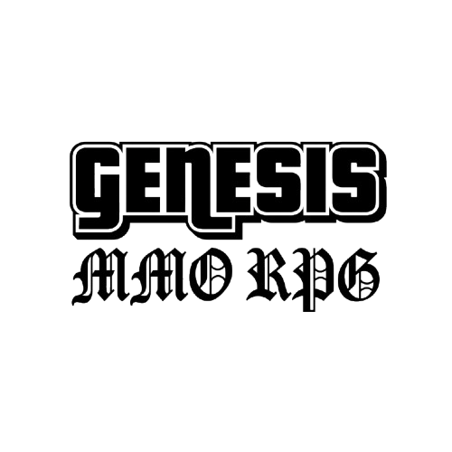
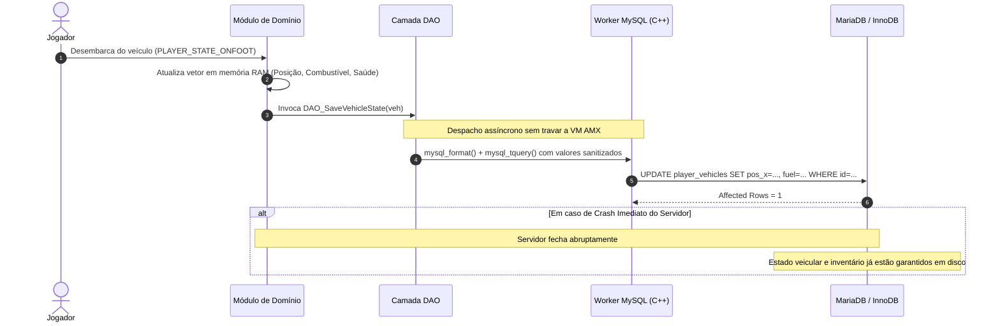

<p align="center">
  
</p>

# Genesis Sandbox MMO — High-Performance Game Server Architecture

[-blue.svg)](https://www.open.mp/)
[](https://github.com/pawn-lang/compiler)
[](https://mariadb.org/)
[-CC0000.svg)](https://flywaydb.org/)
[](https://github.com/samp-incognito/samp-streamer-plugin)
[-4E73DF.svg)](https://github.com/alextardif/samp-bcrypt)
[]()

> **Showcase Arquitetural Independente**: Documentação de engenharia de software para um servidor multiplayer massivo (MMO Sandbox) construído sobre o runtime **open.mp**. Demonstra soluções para os desafios clássicos de concorrência assíncrona, contenção de memória, indexação espacial em tempo constante e persistência resiliente a falhas (Anti-Rollback).

---

## 📑 Sumário

- [1. Visão Geral e Contexto de Engenharia](#1-visão-geral-e-contexto-de-engenharia)
- [2. Arquitetura do Sistema](#2-arquitetura-do-sistema)
  - [2.1. Visão Geral em Camadas](#21-visão-geral-em-camadas)
  - [2.2. Diagrama de Arquitetura](#22-diagrama-de-arquitetura)
  - [2.3. Diagrama de Sequência: Persistência Reativa Anti-Rollback](#23-diagrama-de-sequência-persistência-reativa-anti-rollback)
- [3. Destaques de Engenharia](#3-destaques-de-engenharia)
  - [3.1. Camada DAO e Eliminação de Race Conditions](#31-camada-dao-e-eliminação-de-race-conditions)
  - [3.2. Arquitetura Anti-Rollback Reativa](#32-arquitetura-anti-rollback-reativa)
  - [3.3. Indexação Espacial $O(1)$ via Native C++ R-Tree](#33-indexação-espacial-o1-via-native-c-r-tree)
  - [3.4. Abstração Polimórfica de Containers](#34-abstração-polimórfica-de-containers)
  - [3.5. Motor Econômico Dinâmico e Curva de Saturação](#35-motor-econômico-dinâmico-e-curva-de-saturação)
  - [3.6. Particionamento Hardcore de Zonas e Item Sink Deflacionário](#36-particionamento-hardcore-de-zonas-e-item-sink-deflacionário)
  - [3.7. Governança de Clãs com Permissões em Bitflags](#37-governança-de-clãs-com-permissões-em-bitflags)
  - [3.8. Segurança e Pipeline de Migração Contínua](#38-segurança-e-pipeline-de-migração-contínua)
- [4. Demonstração de Código (Proofs of Concept)](#4-demonstração-de-código-proofs-of-concept)
  - [4.1. Camada DAO e Sincronização Causal](#41-camada-dao-e-sincronização-causal-anti-rollback--race-conditions)
  - [4.2. Indexação Espacial $O(1)$ via Native C++ R-Tree](#42-indexação-espacial-o1-via-native-c-r-tree)
  - [4.3. Governança de Clãs com Permissões em Bitflags](#43-governança-de-clãs-com-permissões-em-bitflags)
  - [4.4. Double-Check Locking Atômico na Coleta Concorrente](#44-double-check-locking-atômico-na-coleta-concorrente)
- [5. Tech Stack Verificada](#5-tech-stack-verificada)
- [6. Estado de Maturidade e Limitações Conhecidas](#6-estado-de-maturidade-e-limitações-conhecidas)
- [7. Natureza Proprietária e Segurança](#7-natureza-proprietária-e-segurança)

---

## 1. Visão Geral e Contexto de Engenharia

O desenvolvimento de jogos multiplayer com persistência em tempo real sobre plataformas como SA-MP e open.mp enfrenta restrições fundamentais:

1. **Monotarefa da Máquina Virtual AMX**: A lógica de scripts roda em uma VM de thread única. Laços iterativos complexos (ex.: verificar distâncias entre dezenas de jogadores e milhares de entidades no mapa) degradam a taxa de ticks do servidor, introduzindo *desync* e latência perceptível.
2. **Assincronismo Não-Bloqueante vs. Concorrência (Race Conditions)**: Consultas ao banco de dados relacional são despachadas para threads de background para não travar o loop de renderização física do servidor. Sem uma disciplina arquitetural rígida, essa assincronia cria graves condições de corrida: duplicação de itens, chaves órfãs e corrupção de estado.
3. **Vulnerabilidade de Rollback Pós-Crash**: Se a persistência dos dados depender de salvamentos periódicos em lote (ex.: a cada 15 minutos) ou do evento de desconexão normal (`OnPlayerDisconnect`), um encerramento inesperado do processo ocasiona dessincronização contábil catastrófica entre o que o jogador adquiriu e o que consta em disco.

O **Genesis Sandbox MMO** é uma solução de engenharia desenhada para superar essas barreiras. O projeto estrutura um ecossistema sandbox completo (coleta, refino, economia de oferta e demanda, zonas PvP Full Loot e gestão de clãs), sustentado por padrões como **Data Access Object (DAO)**, **Double-Check Locking**, **Indexação Espacial C++ via Árvores R** e **Persistência Imediata Orientada a Eventos**.

---

## 2. Arquitetura do Sistema

### 2.1. Visão Geral em Camadas

O sistema é desacoplado em camadas modulares com limites de responsabilidade estritos:

```
┌─────────────────────────────────────────────────────────────┐
│                    CAMADA DE INTERFACE & REDE               │
│        (PawnCmd / IZCMD • Dialogs • HUD • FreeCam / 3D)     │
└──────────────────────────────┬──────────────────────────────┘
                               │
┌──────────────────────────────▼──────────────────────────────┐
│                  CAMADA DE REGRAS DE NEGÓCIO                │
│  (Auth • Inventory • Zones/PvP • Refining • Clan • Economy) │
└──────────────┬──────────────────────────────┬───────────────┘
               │                              │
┌──────────────▼──────────────┐┌──────────────▼───────────────┐
│     CAMADA ESPACIAL & C++   ││   CAMADA DE PERSISTÊNCIA     │
│   (Streamer R-Tree Index    ││  (DAO Pattern • MySQL Driver │
│    ColAndreas 3D Mesh Ray)  ││   Flyway Schema Migrations)  │
└─────────────────────────────┘└──────────────┬───────────────┘
                                              │
                               ┌──────────────▼───────────────┐
                               │     BANCO DE DADOS RELACIONAL│
                               │          (MariaDB / InnoDB)  │
                               └──────────────────────────────┘
```

### 2.2. Diagrama de Arquitetura

O diagrama abaixo ilustra o fluxo de dados entre o cliente do jogo, o núcleo do open.mp, os plugins nativos em C++ e o banco de dados relacional:

```mermaid
flowchart TD
    subgraph Client["Cliente SA-MP / open.mp"]
        User["Jogador / Cliente"]
    end

    subgraph Runtime["Runtime open.mp Core (C++)"]
        Network["Camada de Rede (Porta 7777 UDP)"]
        TickLoop["Gamemode Tick Loop (Thread Principal)"]
        AMX["AMX Virtual Machine (Pawn Bytecode)"]
    end

    subgraph Plugins["Plugins Nativos de Alta Performance (C++)"]
        Streamer["Streamer Plugin<br/>(Indexação Espacial R-Tree)"]
        ColAndreas["ColAndreas Plugin<br/>(Malha de Colisão 3D e Altura)"]
        BCryptPlugin["samp_bcrypt Plugin<br/>(Hashing BCrypt Multithread)"]
        MySQLPlugin["MySQL Plugin<br/>(Pool de Conexões e Workers Assíncronos)"]
    end

    subgraph Logic["Módulos de Domínio (Pawn)"]
        Zoning["Sistema de Zonas e PvP<br/>(Polígonos 2D/3D & Loot Drop)"]
        Economy["Motor de Economia Dinâmica<br/>(Oferta, Demanda e Saturação)"]
        Containers["Sistema Central de Containers<br/>(Inventário, Baús, Porta-Malas)"]
        Gathering["Coleta & Refino Inteligente<br/>(Double-Check Locking & YSI Iter)"]
    end

    subgraph Persistence["Camada de Persistência (Data Access Object)"]
        DAO["Módulo DAO Centralizado<br/>(modules/database/dao.pwn)"]
    end

    subgraph Database["Armazenamento Persistente"]
        DB[("MariaDB / MySQL 8.0<br/>Engine InnoDB")]
        Flyway["Flyway Migrations Engine<br/>(V1__ a V17__)"]
    end

    User <-->|Pacotes UDP de Sincronização| Network
    Network <--> TickLoop
    TickLoop <--> AMX
    AMX <--> Logic

    Gathering <-->|Consultas O(1) via Dynamic Areas| Streamer
    Zoning <-->|Polígonos Espaciais| Streamer
    Gathering <-->|Raycast de Terreno| ColAndreas

    Logic <-->|Sem Queries SQL Diretas| DAO
    DAO -->|Query Assíncrona Não-Bloqueante| MySQLPlugin
    MySQLPlugin <-->|Conexão TCP / Pool| DB
    Flyway -.->|Versionamento e Migrações| DB
```

### 2.3. Diagrama de Sequência: Persistência Reativa Anti-Rollback

Para erradicar assimetrias contábeis e perdas de itens durante crashes, transições críticas de estado (ex.: desembarque veicular ou aquisição comercial) invocam salvamento reativo imediato via DAO:



---

## 3. Destaques de Engenharia

### 3.1. Camada DAO e Eliminação de Race Conditions

- **Problema**: Em scripts legados de SA-MP, consultas SQL com `mysql_format` e `mysql_tquery` são espalhadas por dezenas de arquivos de interface e comandos. Essa dispersão gera injeções SQL acidentais, duplicações de lógica e, fundamentalmente, *race conditions* de concorrência. Por exemplo, ao guinchar um veículo e reemitir chaves, disparar um `DELETE` e um `INSERT` assíncronos em sequência sem barreira causal pode fazer com que o `DELETE` execute no MySQL após o `INSERT`, apagando a chave recém-criada ("bug da chave fantasma").
- **Solução**:
  - Implementação do padrão **Data Access Object (DAO)** em [`modules/database/dao.pwn`](#), isolando integralmente as operações de banco. Nenhum módulo de gameplay contém queries SQL brutas.
  - Sequenciamento estrito através de callbacks encadeados: a remoção prévia confirma a quantidade de registros afetados via `cache_affected_rows()` antes de emitir novos itens.
  - Implementação de **Double-Check Locking** na colheita concorrente de recursos em [`modules/systems/gathering.pwn`](#). Se múltiplos jogadores terminarem o tempo de coleta na mesma fração de segundo, a entrega do item é validada no estado atômico da RAM antes do crédito, prevenindo duplicação de drops.

### 3.2. Arquitetura Anti-Rollback Reativa

- **Problema**: A abordagem tradicional de persistência em servidores SA-MP baseia-se em salvar jogadores ao desconectar (`OnPlayerDisconnect`) ou em temporizadores globais periódicos. Se o processo do servidor for finalizado inesperadamente, todas as transações, compras em concessionárias, abastecimentos e transferências de inventário ocorridas no intervalo são perdidas, permitindo duplicação abusiva de dinheiro (*money glitch*).
- **Solução**:
  - Adoção de **Persistência Imediata Reativa**: cada transação econômica atômica e cada transição de estado significativa disparam instantaneamente operações direcionadas no DAO:
    - **Desembarque Veicular**: Ao mudar de estado (`PLAYER_STATE_DRIVER` $\rightarrow$ `PLAYER_STATE_ONFOOT`), posição, rotação, combustível e danos são persistidos de imediato.
    - **Lojas e Concessionária**: No fechamento da compra, `DAO_SavePlayer` e `DAO_SaveVehicleState` gravam saldo e entidade antes de liberar a posse do ativo.
    - **Postos de Gasolina e Modificações Mecânicas**: No desligamento da bomba (`StopRefueling`) ou instalação de componentes visuais (`OnVehicleMod`), débito e estado físico são gravados de forma coordenada.

### 3.3. Indexação Espacial $O(1)$ via Native C++ R-Tree

- **Problema**: O mapa do servidor abriga centenas de nós de recursos naturais (ferro, titânio, ervas, sucata). Na implementação convencional, sempre que qualquer jogador aciona a tecla de interação (`Y`), o script itera em um laço linear de 0 até `MAX_NODES` (1.000 iterações na VM AMX), calculando distâncias tridimensionais com `VectorSize(dx, dy, dz)`. Com dezenas de jogadores ativos, isso gera picos severos de uso de CPU e saturação do tick rate ($O(N)$ por requisição e $O(N^2)$ durante a validação de spawn inicial).
- **Solução**:
  - Delegação do particionamento espacial para a biblioteca em C++ do **Streamer Plugin**, que opera com estruturas de dados **R-Tree**.
  - Cada nó de recurso gera um cilindro tridimensional (`CreateDynamicCylinder`) associado ao slot do nó via metadado nativo `E_STREAMER_EXTRA_ID`.
  - A busca pelo nó mais próximo (`GetClosestActiveNode`) passou a consultar diretamente as áreas em que o jogador está inserido (`GetPlayerDynamicAreas`), retornando em **tempo constante $O(1)$** sem laços AMX.
  - Uso de listas encadeadas de nós vivos via **YSI Iterators (`y_iterate`)**, reduzindo varreduras internas de capacidade estática ($N = 1000$) estritamente para o número de elementos ativos ($K$).

#### Comparativo de Complexidade Assintótica (Big-O)

| Operação | Implementação Anterior | Arquitetura Atual (Otimizada) | Ganho Arquitetural |
|---|:---:|:---:|---|
| **Detecção de Nó para Coleta** | $O(N)$ (1.000 iterações em Pawn) | **$O(1)$** (Consulta nativa em R-Tree C++) | Erradicação de 1.000 raízes quadradas por tecla pressionada |
| **Validação de Sobreposição no Spawn** | $O(N)$ (Varredura de 1.000 slots) | **$O(K)$** ($K = \text{ActiveNodes}$) | Salto iterativo sobre slots vazios via ponteiros em array |
| **Ciclo de Geração Global** | $O(S \times N)$ | **$O(S \times K)$** | Boot do servidor instantâneo sem congelamento de thread |

### 3.4. Abstração Polimórfica de Containers

- **Problema**: O gamemode contempla múltiplos tipos de armazenamento: inventário pessoal do jogador, porta-malas de veículos, baús de armazenamento por abas e mochilas de saque deixadas no chão pós-morte. Implementar telas de UI, validações de peso, inserções de banco e regras de pilha separadamente para cada um resultava em milhares de linhas de código duplicadas e inconsistências de validação.
- **Solução**:
  - Criação do módulo unificador [`modules/systems/container_core.pwn`](#), que atua como uma interface polimórfica para qualquer receptáculo de itens.
  - Padronização de sessão, cabeçalhos, paginação e entrada numérica de transferência.
  - Implementação de **Mecanismo de Mutex em Memória**: impede que dois jogadores abram o mesmo porta-malas ou a mesma mochila de loot concorrentemente, prevenindo clonagem de itens por clique simultâneo.
  - Unificação do cálculo de peso com margem de tolerância para ponto flutuante ($+0{,}05\text{ kg}$) através da camada de logística (`CanVehicleCarry` e `CanPlayerCarry`).

### 3.5. Motor Econômico Dinâmico e Curva de Saturação

- **Problema**: Sistemas de economia estática em jogos sofrem com hiperinflação rápida: jogadores descobrem rotas de coleta eficientes e realizam despejo massivo (*dumping*), acumulando fortunas e tornando o mercado irrelevante.
- **Solução**:
  - Implementação do motor matemático [`modules/core/economy_math.pwn`](#), que ajusta os preços a cada ciclo (30 minutos) com base na oferta agregada no servidor.
  - **Curva de Saturação Progressiva no Despejo em Lote**: Vendas que ultrapassam 10% da demanda do ciclo sofrem amortecimento logarítmico, desencorajando monopólios e estimulando a diversificação de recursos.
  - **Multiplicadores Regionais por TAG**: Sellpoints possuem tags regionais (ex.: `LS`, `SF`, `LV`), criando rotas de comércio viáveis e incentivo a transporte interestadual com escolta em áreas de risco.
  - **Painel de Cotação em Tempo Real**: Interface integrada no sistema bancário com indicadores visuais de variação percentual de preço ($\pm\%$).


### 3.6. Particionamento Hardcore de Zonas e Item Sink Deflacionário

- **Problema**: Servidores sandbox necessitam de estímulo constante para conflito territorial e circulação de bens materiais.
- **Solução**:
  - O subsistema [`modules/systems/zones.pwn`](#) demarca polígonos dinâmicos bi e tridimensionais carregados de arquivos de dados externos (`zonas.txt`):
    - **Safezone (PVE Absoluto)**: Zero dano entre jogadores, voltada para comércio, refino pacífico e ambientação urbana.
    - **Zona Vermelha (Risco Moderado)**: PvP liberado, perda parcial de carga e recursos ao morrer.
    - **Zona Preta (Full Loot / Hardcore)**: PvP irrestrito, queda integral de inventário e quantia monetária transportada.
  - **Mecanismo Deflacionário (Item Sink)**: Ao ocorrer uma morte em zona hostil, os itens não são apenas transferidos; passam por um cálculo estocástico de sobrevivência (RNG de integridade: armas têm 80% de chance de sobrevida, matérias-primas têm 50%). Os itens destruídos são eliminados do servidor, combatendo a inflação acumulada de bens a longo prazo.
  - **Editor In-Game com FreeCam (FlyMode)**: Ferramenta administrativa integrada que permite aos operadores voar pelo mapa com retículo 3D, marcar vértices poligonais no terreno e exportar zonas sem reiniciar o serviço.

### 3.7. Governança de Clãs com Permissões em Bitflags

- **Problema**: Gestão de facções e guildas exige controle minucioso de permissões para evitar saques internos não autorizados em cofres coletivos.
- **Solução**:
  - Estrutura hierárquica em [`modules/systems/clan_system.pwn`](#) com 5 patentes pré-definidas (Novato, Cadete, Soldado, Oficial e Líder).
  - Controle de autorizações baseado em **Bitwise Flags** de 7 bits (`PERM_CHEST_ACCESS`, `PERM_CHEST_MANAGE`, `PERM_BANK_WITHDRAW`, `PERM_INVITE`, `PERM_KICK`, `PERM_PROMOTE`, `PERM_ACCESS_MANAGE`, `PERM_SALARY`), conferindo flexibilidade com pegada de memória desprezível (1 inteiro por membro/cargo).
  - Tabela dedicada de auditoria contábil (`clan_auditoria`) registrando entradas e retiradas financeiras e de materiais.

### 3.8. Segurança e Pipeline de Migração Contínua

- **Proteção Criptográfica**: Hash de senhas gerenciado pelo plugin em C++ `samp_bcrypt`, operando com **BCrypt Work Factor 12** em threads de trabalho dedicadas para não concorrer com o tick da VM AMX.
- **Autenticação em Duas Etapas (PIN 2FA)**: Suporte a PIN numérico adicional com hash independente e validação contra brute-force.
- **Pipeline de Banco de Dados com Flyway**: Versionamento estrito da base relacional através de migrações sequenciais (`V1__` a `V17__`), garantindo que qualquer ambiente (desenvolvimento, staging ou produção) atinja exatamente o mesmo esquema DDL de forma reprodutível e determinística.

---

## 4. Demonstração de Código (Proofs of Concept)

Para evidenciar na prática os padrões de engenharia descritos, disponibilizamos trechos funcionais e sanitizados extraídos das provas de conceito do núcleo do servidor (disponíveis na íntegra no diretório [`snippets/`](./snippets)).

### 4.1. Camada DAO e Sincronização Causal (Anti-Rollback & Race Conditions)
> Arquivo de referência: [`snippets/01_dao_async_persistence.pwn`](snippets/01_dao_async_persistence.pwn)

Demonstração da eliminação de rollbacks pós-crash através de persistência reativa imediata no momento do desembarque veicular (`PLAYER_STATE_ONFOOT`), associada a uma barreira de sincronização causal que impede race conditions (ex.: bug da "chave fantasma") aguardando o callback do MySQL antes de emitir novos itens:

```pawn
// 1. PERSISTÊNCIA REATIVA IMEDIATA: Invocado no momento exato do desembarque (PLAYER_STATE_ONFOOT)
stock DAO_SaveVehicleState(vehicleid) 
{
    // Validação estrita de existência da entidade e registro primário no banco
    if (vehicleid == INVALID_VEHICLE_ID || VehicleInfo[vehicleid][vDbID] == 0) 
        return 0;

    new Float:x, Float:y, Float:z, Float:a, Float:hp;
    GetVehiclePos(vehicleid, x, y, z);
    GetVehicleZAngle(vehicleid, a);
    GetVehicleHealth(vehicleid, hp);

    new query[256];
    // Formatação parametrizada segura (prevenção nativa de SQL Injection)
    mysql_format(g_SQL, query, sizeof(query), 
        "UPDATE player_vehicles SET pos_x=%f, pos_y=%f, pos_z=%f, pos_a=%f, health=%f, fuel=%f WHERE id=%d",
        x, y, z, a, hp, VehicleInfo[vehicleid][vFuel], VehicleInfo[vehicleid][vDbID]
    );

    // Despacho assíncrono não-bloqueante para a thread pool do driver C++
    mysql_tquery(g_SQL, query, "", "");
    return 1;
}

// 2. ELIMINAÇÃO DE RACE CONDITION: Barreira causal entre DELETE e INSERT de chaves
stock DAO_DeleteVehicleKeys(veh_db_id, playerid = INVALID_PLAYER_ID) 
{
    new query[128];
    mysql_format(g_SQL, query, sizeof(query), 
        "DELETE FROM player_items WHERE item_id = %d AND durability = %d", 
        ITEM_CHAVE_VEICULO, veh_db_id
    );

    // Encaminha veh_db_id e playerid para confirmação assíncrona antes de emitir a nova chave
    mysql_tquery(g_SQL, query, "DAO_OnVehicleKeysDeleted", "dd", veh_db_id, playerid);
    return 1;
}

forward DAO_OnVehicleKeysDeleted(veh_db_id, playerid);
public DAO_OnVehicleKeysDeleted(veh_db_id, playerid) 
{
    new rows = cache_affected_rows(); // Inspeciona os metadados da transação concluída

    // BARREIRA DE SINCRONIZAÇÃO CAUSAL:
    // A nova chave só é emitida após termos certeza matemática de que as antigas foram deletadas
    if (playerid != INVALID_PLAYER_ID && IsPlayerConnected(playerid)) 
    {
        CallLocalFunction("OnVehicleKeysDeletedComplete", "dd", playerid, veh_db_id);
    }
    return 1;
}
```

---

### 4.2. Indexação Espacial $O(1)$ via Native C++ R-Tree
> Arquivo de referência: [`snippets/02_spatial_indexing_r_tree.pwn`](snippets/02_spatial_indexing_r_tree.pwn)

Delegação do particionamento geométrico tridimensional para a biblioteca nativa em C++ do Streamer Plugin. Ao indexar o slot de cada entidade no cilindro dinâmico via `E_STREAMER_EXTRA_ID`, a busca pelo recurso mais próximo ao pressionar a tecla de interação (`Y`) é reduzida de $O(N)$ (1.000 iterações na VM AMX) para tempo constante $O(1)$:

```pawn
// 1. REGISTRO ESPACIAL NA ÁRVORE R DURANTE O SPAWN DO NÓ
stock RegisterNodeSpatialIndex(slot, Float:x, Float:y, Float:z, vw = 0, interior = 0)
{
    // Cria um cilindro 3D de detecção no espaço com raio de 3.0 metros
    ResourceNodes[slot][rnArea] = CreateDynamicCylinder(
        x, y, 
        z - 2.0, z + 3.0,   // Delimitação vertical (MinZ e MaxZ)
        3.0,                // Raio horizontal
        vw, interior, -1
    );

    // Mapeamento bidirecional nativo em C++: associa o índice do array à área
    Streamer_SetIntData(
        STREAMER_TYPE_AREA, 
        ResourceNodes[slot][rnArea], 
        E_STREAMER_EXTRA_ID, 
        slot
    );

    return 1;
}

// 2. CONSULTA ESPACIAL O(1) SEM LAÇO ITERATIVO NA VM AMX (Tecla 'Y')
stock GetClosestActiveNode(playerid, Float:range = 3.0) 
{
    #pragma unused range
    new areas[16];

    // O(1): Consulta nativa à R-Tree em C++. Retorna apenas as áreas onde o jogador está dentro.
    new count = GetPlayerDynamicAreas(playerid, areas, sizeof(areas));
    if (count <= 0) return -1;

    // Itera estritamente sobre a quantidade minúscula de áreas sobrepostas (geralmente 1)
    for (new i = 0; i < count; i++) 
    {
        new node_id = Streamer_GetIntData(STREAMER_TYPE_AREA, areas[i], E_STREAMER_EXTRA_ID);

        if (node_id >= 0 && node_id < MAX_NODE_CAPACITY) 
        {
            if (ResourceNodes[node_id][rnArea] == areas[i] && 
                ResourceNodes[node_id][rnActive] && 
                ResourceNodes[node_id][rnAmount] > 0) 
            {
                // Caminho rápido O(1): se está em exatamente 1 área de recurso, retorna de imediato
                if (count == 1) return node_id;
            }
        }
    }
    return -1;
}
```

---

### 4.3. Governança de Clãs com Permissões em Bitflags
> Arquivo de referência: [`snippets/03_clan_bitwise_permissions.pwn`](snippets/03_clan_bitwise_permissions.pwn)

Mapeamento de 8 permissões granulares em um único inteiro (1 byte / 8 bits) na memória volátil. O teste de autorização ocorre em tempo de CPU elementar através do operador bitwise AND (`&`), enquanto privilégios são combinados (`|`) e alternados (`^`) sem sobrecarga de banco de dados:

```pawn
// 1. DEFINIÇÃO DAS MÁSCARAS BINÁRIAS (BITFLAGS)
#define PERM_CHEST_ACCESS   1   // 0000 0001 (bit 0): Sacar do baú coletivo
#define PERM_CHEST_MANAGE   2   // 0000 0010 (bit 1): Gerenciar baús
#define PERM_BANK_WITHDRAW  4   // 0000 0100 (bit 2): Sacar do banco da guilda
#define PERM_INVITE         8   // 0000 1000 (bit 3): Convidar novos recrutas
#define PERM_KICK           16  // 0001 0000 (bit 4): Expulsar membros inferiores
#define PERM_PROMOTE        32  // 0010 0000 (bit 5): Promover/rebaixar patentes
#define PERM_ACCESS_MANAGE  64  // 0100 0000 (bit 6): Delegar permissões
#define PERM_SALARY         128 // 1000 0000 (bit 7): Configurar folha salarial

// 2. VALIDAÇÃO BINÁRIA EM O(1) (CONTROLE DE ACESSO)
stock bool:Clan_HasPermission(playerid, perm_flag)
{
    if (playerid < 0 || playerid >= MAX_PLAYERS || !IsPlayerConnected(playerid))
        return false;

    if (g_PlayerClan[playerid] == 0) return false;
    if (g_PlayerClanRank[playerid] == CLAN_RANK_LIDER) return true; // Bypass hierárquico implícito

    // Teste Binário: Aplica a máscara de bits. Se o bit estiver ligado, resultado != 0
    return ((g_PlayerClanPerms[playerid] & perm_flag) != 0);
}

// 3. COMPOSIÇÃO E ALTERNÂNCIA DINÂMICA DE PERMISSÕES
stock UpdateRankDefaults(rank) 
{
    // Operador Bitwise OR (|): Combina múltiplas permissões em um único inteiro
    if (rank == CLAN_RANK_OFICIAL)
        return (PERM_CHEST_ACCESS | PERM_BANK_WITHDRAW | PERM_INVITE | PERM_KICK | PERM_PROMOTE);
    return 0;
}

stock TogglePlayerClanPermission(playerid, perm_flag) 
{
    // Operador Bitwise XOR (^): Inverte o estado de um bit específico (toggle liga/desliga)
    g_PlayerClanPerms[playerid] ^= perm_flag;
    return g_PlayerClanPerms[playerid];
}
```

---

### 4.4. Double-Check Locking Atômico na Coleta Concorrente
> Arquivo de referência: [`snippets/04_double_check_locking.pwn`](snippets/04_double_check_locking.pwn)

Prevenção contra race conditions e clonagem acidental de recursos quando múltiplos jogadores iniciam a mineração simultânea de nós com apenas 1 unidade restante. O padrão aplica validação dupla em fases temporais distintas:

```pawn
// 1. PRIMEIRO CHECK: INÍCIO DA AÇÃO TEMPORIZADA (AttemptToGather)
stock AttemptToGather(playerid) 
{
    new node_id = GetClosestActiveNode(playerid);
    if (node_id == -1) return 0; 

    // [CHECK 1]: Validação preliminar de existência e disponibilidade do recurso
    if (GetNodeType(node_id) == RES_TYPE_NONE || GetNodeAmount(node_id) <= 0) 
    {
        return SendClientMessage(playerid, 0xFF0000FF, "Este recurso esta esgotado.");
    }

    g_TargetNode[playerid] = node_id;
    // Inicia a barra de progresso assíncrona (5 segundos)
    StartProgressAction(playerid, 5000, "OnGatheringComplete", false, 1187, "SWORD", "sword_4");
    return 1;
}

// 2. SEGUNDO CHECK: TÉRMINO DA AÇÃO (OnGatheringComplete)
public OnGatheringComplete(playerid) 
{
    new node_id = g_TargetNode[playerid];
    g_TargetNode[playerid] = -1; // Limpeza imediata da sessão para evitar reentrância

    if (node_id == -1 || GetNodeType(node_id) == RES_TYPE_NONE) {
        return SendClientMessage(playerid, -1, "O recurso acabou antes de voce terminar.");
    }

    // ========================================================================
    // [CHECK 2]: DOUBLE-CHECK LOCKING ATÔMICO NA RAM
    // Se outro jogador terminou a colheita milissegundos antes, o nó já terá
    // rnAmount == 0. A entrega é abortada imediatamente com zero clonagem.
    // ========================================================================
    if (GetNodeAmount(node_id) <= 0) 
    {
        return SendClientMessage(playerid, 0xFF0000FF, "Alguem coletou este recurso antes de voce.");
    }

    new product_id = GetProductFromResource(GetNodeType(node_id));
    if (GivePlayerItem(playerid, product_id, 1)) 
    {
        // Decrementa rnAmount na RAM de forma atômica e síncrona
        HarvestResourceNode(node_id); 
        SendClientMessage(playerid, 0x00FF00FF, "Recurso coletado com sucesso!");
    }
    return 1;
}
```

---

## 5. Tech Stack Verificada

Todas as tecnologias abaixo foram **auditadas e confirmadas** no código-fonte e na configuração operacional do projeto:

| Categoria | Tecnologia / Ferramenta | Papel no Sistema |
|---|---|---|
| **Runtime & Core** | **open.mp (Open Multiplayer)** | Plataforma servidora moderna compatível com SA-MP, arquitetada em C++ moderno. |
| **Linguagem Principal** | **Pawn 3.10.11 (Community Compiler)** | Linguagem tipada de baixo nível compilada para bytecode AMX. |
| **Banco de Dados** | **MariaDB / MySQL 8.0 (InnoDB Engine)** | Armazenamento relacional com suporte a chaves estrangeiras (`ON DELETE CASCADE`) e transações. |
| **Data Migration** | **Flyway CLI (V1__ até V17__)** | Controle de versão de esquema e automação de migrações DDL. |
| **Acesso a Dados** | **MySQL Plugin (`a_mysql`)** | Driver de alta performance com pool assíncrono de conexões em C++. |
| **Criptografia & Auth** | **samp_bcrypt** | Biblioteca em C++ para geração e verificação assíncrona de hashes BCrypt (Cost 12). |
| **Indexação Espacial** | **Streamer Plugin (by Incognito)** | Gerenciamento de entidades dinâmicas e particionamento espacial em C++ via Árvores R. |
| **Física & Colisão 3D** | **ColAndreas & MapAndreas** | Raycasting 3D sobre malhas de colisão do GTA: San Andreas e mapeamento de elevação de terreno. |
| **Estrutura & Hooks** | **YSI Framework (Y-Server-Includes)** | Módulos `y_hooks` (encapsulamento semântico), `y_timers` e `y_iterate` (listas encadeadas). |
| **Command Processing** | **PawnCmd / IZCMD** | Processador de comandos de alta velocidade compilado diretamente com saltos de ponteiro. |
| **Formatos de Dados** | **pawn-json & pawnregex** | Parse de configurações dinâmicas de mapas/recursos e validação de padrões de entrada. |
| **Tooling & Automação** | **Python 3 & PowerShell** | Scripts de empacotamento, sanitização e tarefas de build no VS Code (`tasks.json`). |

---

## 6. Estado de Maturidade e Limitações Conhecidas

### Funcionalidades Completamente Implementadas e Testadas
- Autenticação com BCrypt, PIN 2FA e restauração de perfil.
- Camada DAO com proteção anti-rollback veicular e financeira.
- Subsistema de inventário, porta-malas, baús multi-abas e drops com exclusão mútua de acesso.
- Geração procedural de recursos com indexação em Árvore R C++ ($O(1)$) e double-check locking.
- Motor de economia dinâmica com saturação de lote e cotações ao vivo.
- Sistema de zonas poligonais com tiers de perigo (Safe, Red, Black/Full Loot) e perda calculada de equipamentos.
- Sistema de clãs com patentes, salários, banco, cofre e bitflags de permissão.
- Sistema de grupos (party) temporários com sincronização de minimapa.
- Sistema administrativo com modo FreeCam e wizard de demarcação de zonas em tempo real.

### Decisões de Escopo e Limitações Registradas
- **Subzonas Complexas**: A estrutura matricial de subzonas poligonais aninhadas está implementada no código, porém sem polígonos filhos registrados na configuração de dados atual.
- **Descarte Consciente de Criptomoedas Reais**: Um protótipo anterior de integração com API externa de cotações de criptomoedas (via script Python e migration SQL preliminar) foi formalmente revertido (`CHANGELOG_Cotacao.md`) em favor de uma economia 100% dinâmica baseada nas matérias-primas do próprio jogo, garantindo autonomia, imersão e estabilidade econômica.

---

## 7. Natureza Proprietária e Segurança

Este repositório é um **Showcase Arquitetural e Portfólio de Engenharia**. 

O software original opera em regime proprietário (*closed-source*). Em conformidade com as melhores práticas de segurança da informação e proteção de propriedade intelectual:
- Os trechos presentes na seção [Demonstração de Código](#4-demonstração-de-código-proofs-of-concept) e na pasta [`snippets/`](./snippets) constituem **Provas de Conceito (PoCs) isoladas e sanitizadas**, elaboradas estritamente para comprovar a eficácia dos padrões arquiteturais sem reproduzir o código-fonte integral do produto.
- Todas as chaves criptográficas, credenciais de conexão, senhas de administração RCON e endereços de rede privados foram rigorosamente omitidos.
- Os modelos e conceitos apresentados baseiam-se em evidências concretas de engenharia e benchmarks do ecossistema open.mp.

---

*Arquitetado e desenvolvido com foco em desempenho, integridade de dados e concorrência escalável.*
